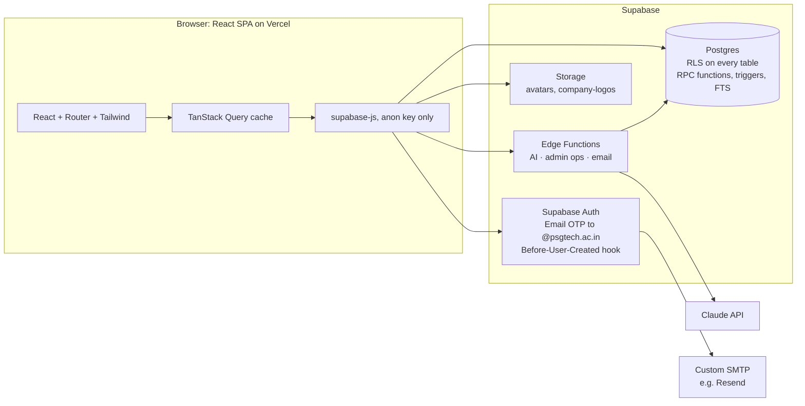
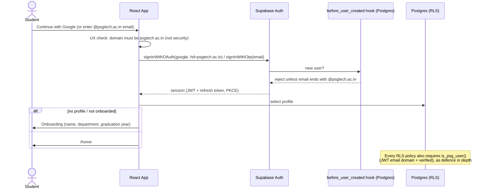
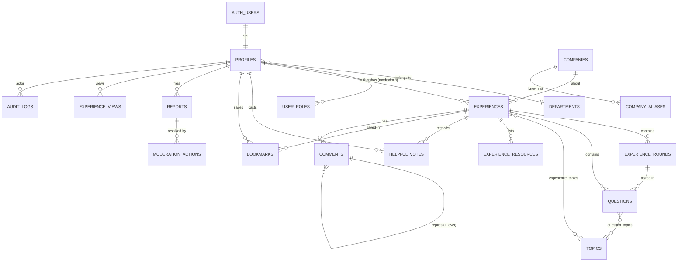

# PSG InterviewShare: Product Discovery & Proposed Architecture

> **Status:** DRAFT v0.1. Waiting for approval. No application code has been written.
> **Date:** 2026-11-13
> **Decision log:** [DECISIONS.md](DECISIONS.md)

---

## 1. Product understanding

**One-line thesis:** a verified, PSG-only knowledge base that turns individual interview stories into *structured, searchable, cross-linked placement intelligence*.

Most "experience sharing" sites are collections of essays. Their value grows linearly: one more post, one more page to read. This product should grow **compounding** value. Each submission adds:

1. A readable story (the experience itself).
2. Structured facts (company, role, rounds, difficulty, outcome, batch, department).
3. Atomic, tagged **questions** that feed a company question list and a topic-wise question bank.

The third point is the differentiator. A student preparing for Amazon shouldn't have to read 14 essays. They should open the Amazon page and see: "Typical process: OA → 2 technical → HR. Most reported topics: Arrays, DP, OS. 37 questions reported by PSG students in the last 2 years." Every claim links back to the source experiences.

**Primary users**
| Persona | Need | Moment of use |
|---|---|---|
| Pre-placement student (3rd year) | "What do companies actually ask PSG students? How should I prepare?" | Months before placements, browsing and bookmarking |
| Active candidate | "Company X is visiting on Friday. What happens in each round?" | 1 to 7 days before an interview, focused and urgent |
| Contributor (just interviewed) | "I want to help juniors without it taking an hour or exposing me." | Right after an interview or result |
| Moderator / admin | "Keep content accurate, safe and spam-free with little effort." | A few minutes a week |

**Success metrics (post-launch)**
- Activation: % of verified sign-ups who complete onboarding and view 3 or more experiences in week 1.
- Contribution rate: experiences published per placement season ÷ students placed.
- Coverage: % of companies visiting PSG with 1 or more experience in the last 2 years.
- Usefulness: helpful votes per view, and bookmark rate.
- Trust: reports per 100 experiences, and median moderation turnaround.

---

## 2. Reference website analysis (interview-share.vercel.app)

### What I could inspect
Landing page, `/experiences` explorer with filters and cards, `/about`, and `/login`.

### What I could not inspect
The **experience detail page**, the **submission form** (`/create`), profile and any admin area. All of them redirect straight to Google sign-in. I did not sign in on your behalf. If you want those analyzed, you can share screenshots, or sign in yourself and I'll review the pages you open.

### Observed facts
| Area | Observation |
|---|---|
| Stack | React SPA on Vercel. The separate backend is on `onrender.com` and uses Google OAuth. Record IDs look like MongoDB ObjectIds (inferred). The Google consent URL has no `hd=` domain hint, so domain restriction must happen after sign-in. |
| Content | 78 experiences (7 pages × 12). Mostly 2025 and 2026: Amazon, SAP, Cisco, HPE, Citi, Deloitte and others. |
| Navigation | Home · Experiences · About, theme toggle, Login. There is no company directory and no question bank. |
| Landing | Dark hero, gradient headline, search box, "Popular Companies". That section shows **"No Companies Yet"** even though 78 experiences exist, so it's broken. The four generic benefit tiles include an "Alumni Network" that doesn't exist. |
| Explorer | Filters are hidden behind "Show Filters": search, company, role, internship type, location, sort, branch, department, graduation year. Numbered pagination. Full-page spinner ("Loading experiences…") with no skeletons, slow on cold start (Render free tier sleeps). |
| Cards | Logo/initial, company, role, type · location, **★ 5 rating** and rounds count, truncated "Tip", round-type chips and hashtags. |
| Gating | The list is public. Clicking any card triggers an immediate Google redirect with no explanation screen. |
| About | Long marketing page. It claims "thousands of experiences", "Analytics", placement-office review of flagged content, and lists `placement@psgtech.ac.in`. |

### What it does well
- Proves demand. A PSG student built it and peers contributed 78 detailed experiences.
- Right core entity (experience) and sensible filter dimensions (type, department, batch).
- The **"Tip" preview on cards** is a good idea. It gives scannable value before clicking.
- Login restricted to PSG accounts.

### Problems and gaps
1. **Broken first impression.** The landing page says "No Companies Yet" while there are 78 experiences. A landing page must never contradict the product.
2. **Meaningless signals.** Every card I saw has a ★5 rating, which carries no information. Hashtags repeat the company, role and type already shown (`#amazon #sde intern #summer`). The rounds count appears twice per card.
3. **Overclaiming.** "Thousands of experiences", "Alumni Network" and "Analytics" don't exist, and naming the placement office implies official endorsement. That erodes trust in an otherwise genuine product.
4. **Prose-only data.** Questions live inside free text, so there is no question bank, no topic frequency and no "what does Company X usually ask".
5. **No company hub.** Students think "I'm preparing for Zoho", not "let me filter a list". The company is the natural landing point.
6. **Filter UX.** Filters are hidden by default and use free-text comboboxes for enumerations. Branch *and* Department is a confusing overlap. There is no filter for **outcome** or **difficulty**, and "Location: On-site" carries little value.
7. **Loading and performance.** Full-page spinner, cold-start latency, no skeletons.
8. **Visual language.** Dark-by-default, gradient text and glow blobs look like a template. Emoji (💡) mix with icon sets. The headline-heavy hero communicates a slogan, not what's inside.
9. **Gating without explanation.** Sending a visitor straight to Google with no context ("Why do I need to sign in?") loses people.

> **Strategic note to challenge you on:** this product already exists for the same audience and already has content. A second PSG platform splits a small community's contributions. That's the biggest risk to *both* products. See Question Q1.

---

## 3. Recommended product improvements (our differentiators)

| # | Improvement | Why it matters |
|---|---|---|
| 1 | **Structured questions as first-class data**, tagged by topic and round | Powers company question lists, the topic question bank, "asked in N other experiences" and future AI, with no AI needed for MVP |
| 2 | **Company hubs** with auto-derived insights: typical round pipeline, difficulty distribution, top topics, selection ratio *as reported* | Matches how students actually prepare |
| 3 | **Helpful votes instead of star ratings** | Ranks by usefulness to readers, not self-assessment |
| 4 | **Outcome and batch on every card** ("Selected · CSE '26") | The two strongest relevance and trust signals for a reader |
| 5 | **Anonymous posting with accountability**: identity is hidden from readers but known to the system | Students won't share rejections or hard truths under their name |
| 6 | **Wizard with autosave and drafts**: ~5 focused steps, round builder, inline question capture | Contribution is the bottleneck. A 25-minute form gets abandoned. |
| 7 | **Honest data everywhere.** Stats come only from real counts, and empty states say "be the first" | Trust compounds |
| 8 | **Student-reported vs official labels** on all company info | Clear provenance |
| 9 | **Fast, calm, light UI**: skeletons, URL-synced filters, mobile bottom nav | The audience reads on phones the night before an interview |
| 10 | **Cold-start plan.** Seed content through placement reps and class groups *before* launch | An empty knowledge base is a dead product |

---

## 4. Feature architecture

Legend: **MVP** = launch · **v1.1** = first iteration after launch · **Later** = when data or usage justifies it · **No** = not recommended

### 4.1 Core modules
| Module | Scope | Release |
|---|---|---|
| A. Landing | Hero with real value prop, live counts (only when above threshold), featured companies, recent experience teasers (company + role + batch, no body), how it works, sign-in | MVP |
| B. Auth & onboarding | Email sign-in code to the college address (D19), domain enforcement on the server, 2-step onboarding (name, department, graduation year, optional avatar and interests), sign out, delete account | MVP |
| C. Dashboard | Welcome, continue-your-draft, recent experiences, trending companies (by views and new posts in 30 days), recently viewed, bookmarks, quick share | MVP. "Popular questions" in v1.1 |
| D. Experience explorer | Full-text search, filters (company, role, type, department, batch, difficulty, outcome, hiring mode), sort (latest, most helpful, most viewed), URL-synced state, "Load more" pagination | MVP |
| E. Company explorer | Directory (search, industry filter, A–Z, by experience count), company page tabs: Overview · Experiences · Questions, derived insights, provenance labels | MVP (derived insights). Curated prep guides later. |
| F. Submission wizard | 5 steps, round builder, structured questions, autosave, drafts, preview, publish, edit after publish | MVP |
| G. Experience detail | Header, at-a-glance strip, round timeline, questions with topic tags, prep and resources, advice, helpful vote, bookmark, share link, report, comments, related experiences | MVP |
| H. Profile | Own profile (published, drafts, saved, stats), public profile with privacy controls, settings | MVP |
| I. Moderation & admin | Report queue, hide/restore/remove, user suspend, company management (merge duplicates, verify, logo), role management, audit log, overview metrics | MVP (essential subset) |

### 4.2 Additional ideas: evaluation
| Feature | Student value | Cost / risk | Recommendation |
|---|---|---|---|
| Anonymous sharing with safeguards | High (honesty, rejections) | Low. Must be enforced in the DB, not the UI. | **MVP** |
| Helpful voting | High | Low | **MVP** |
| Topic-wise question categorization (manual tags) | High | Low | **MVP** |
| Duplicate detection (same author + same drive) | Medium | Low | **MVP** |
| Company-wise prep guides (auto-derived stats) | High | Medium | **MVP** (stats only) |
| Technical question bank (global, by topic) | High | Low once questions are structured | **v1.1** |
| Notifications (in-app: comments, replies, moderation) | Medium | Medium | **v1.1** |
| Personalized recommendations (rule-based: department, interests, bookmarks) | Medium | Low | **v1.1** |
| Contribution badges (few and meaningful) | Low–medium | Low | **v1.1** |
| AI question auto-tagging (suggest, author confirms) | Medium | Low cost, low risk | **v1.1** |
| AI company summaries (grounded, cited, N ≥ 3) | High | Medium. Hallucination risk is managed by grounding. | **v1.1** |
| AI experience TL;DR | Medium | Low | **v1.1** |
| Alumni contributions | High | Depends on email lifecycle (Q4) | **v1.1** |
| Reputation points system | Low | Invites gaming and spam in a small community | **Later / maybe never** |
| Interview comparison | Low | Medium | **Later** |
| Prep roadmaps (editorial) | Medium | Ongoing editorial effort | **Later** |
| Natural-language search | Low until more than about 2k experiences | Medium | **Later.** Postgres full-text search is enough. |
| AI preparation plans | Medium | Risk of confident generic advice | **Later**, grounded only |
| AI practice-question generation | Low–medium | High fabrication risk ("asked at Amazon" claims) | **No** for company-specific. Maybe generic by topic, later. |
| AI mock interviews | Low for *this* product | High cost and scope. It's a different product. | **No** |

---

## 5. Initial sitemap

```
PUBLIC
/                         Landing
/login                    Sign in (6-digit code to the college email)
/about  /guidelines  /privacy  /terms

VERIFIED STUDENT (signed in + onboarded)
/onboarding               2 steps: profile → interests (skippable)
/home                     Dashboard
/experiences              Explorer  (?q=&company=&type=&dept=&year=&outcome=&difficulty=&sort=)
/experiences/:id          Detail
/companies                Directory
/companies/:slug          Overview · Experiences · Questions
/share                    New experience wizard
/share/:draftId           Resume draft / edit
/saved                    Bookmarks
/me                       My profile (Published · Drafts · Saved · Stats)
/u/:handle                Public profile (privacy-respecting)
/settings                 Profile · Privacy · Account (export, delete)
/questions                Question bank                                  (v1.1)
/notifications                                                           (v1.1)

MODERATOR
/mod                      Reports queue · Hidden content

ADMIN
/admin                    Overview metrics
/admin/users              Users, roles, suspensions
/admin/companies          Create / edit / merge / verify
/admin/reports            All reports + actions
/admin/audit              Audit log
/admin/settings           Platform settings (rate limits, feature flags, announcement banner)
```

---

## 6. Proposed technology architecture



**Frontend:** Vite + React (JavaScript), React Router, Tailwind CSS, Lucide icons. Proposed additions, each justified:
- **TanStack Query.** Caching, pagination, optimistic votes and bookmarks, background refetch. Removes most hand-written loading and error state.
- **react-hook-form + zod.** The wizard has about 40 fields and dynamic rounds. Zod schemas mirror the DB `CHECK` constraints.
- **react-markdown (no raw HTML)** for safe rendering of long-form answers.
- **Radix UI primitives** (Dialog, Popover, Select, Tabs, Toast). Accessible behaviour without fighting a UI kit's styling. Fully styled with Tailwind.

**Backend: no Express.** I agree with your instinct. Every MVP requirement maps to Supabase:
| Need | Where |
|---|---|
| CRUD with ownership | PostgREST + RLS |
| Multi-table writes (publish experience + rounds + questions atomically) | Postgres RPC function (`SECURITY DEFINER`, validated) |
| Counters (helpful_count, comment_count) | Triggers |
| Domain restriction | Auth hook (Postgres function) |
| Rate limits on content | Triggers on insert |
| Search | `tsvector` + GIN index, `pg_trgm` for fuzzy company names |
| AI calls, privileged admin ops (e.g. deleting an auth user) | Edge Functions (secrets stay server-side) |

An Express server would only be justified by long-running jobs, heavy integrations or websockets beyond Supabase Realtime. None of those are in scope.

**JavaScript vs TypeScript:** JavaScript is fine. I'll keep zod for runtime validation. You can adopt TypeScript later without a rewrite.

---

## 7. Recommended authentication workflow

> **Updated 2026-11-14 (D19):** the product owner chose **college-email sign-in only**. Students enter their @psgtech.ac.in address and type a 6-digit code sent to that inbox. There is no Google sign-in. The Google-related parts below are kept for history; layers 1, 3 and 4 of the enforcement model are unchanged, and layer 2 no longer applies.

**Key finding:** `psgtech.ac.in` mail is hosted on **Google Workspace** (its MX records point to `aspmx.l.google.com`). Every PSG student therefore already has a Google identity, which makes Google sign-in the lowest-friction way to verify ownership.

**Recommendation:** Google sign-in as the primary button, email 6-digit OTP as the fallback. Both are verified ownership. OTP code is preferred over magic link: links break when students open the email on another device, and corporate scanners can pre-click links.



**Enforcement layers**
1. UI validation. Convenience only.
2. Google `hd` parameter. Pre-selects the PSG account. A *hint*, not security.
3. **Supabase "Before User Created" auth hook.** Authoritative. A non-PSG user is never created. (Fallback: a `BEFORE INSERT` trigger on `auth.users` that raises.)
4. **RLS helper `is_psg_user()`** on every policy. Checks the JWT email domain. Protects against misconfiguration of layer 3.
5. Disable password sign-ups, anonymous sign-ins and all other providers.

**Operational requirements**
- **Custom SMTP is mandatory** for OTP. Supabase's built-in email service is heavily limited and meant only for testing.
- Session: supabase-js session with auto refresh. Sign-out revokes the refresh token. Settings offers "Sign out of all devices".
- Account deletion: an Edge Function deletes the auth user. Content is anonymised to "Former student" or deleted, your choice (Q8).

**Profile data to collect** (minimum necessary)
| Field | Required | Notes |
|---|---|---|
| Full name | Yes | Prefilled from Google |
| Department / programme | Yes | Lookup table of PSG programmes (BE/BTech/ME/MCA/MSc…) |
| Graduation year | Yes | Drives "batch" labels |
| Avatar | No | Google photo by default, upload optional |
| Interests / target roles / skills | No | Personalization only |
| Roll number | **No** | Not needed. The PSG email local part (e.g. `22e646`) already *is* a roll-number-like identifier, so **the email must never be shown publicly.** |

---

## 8. UI/UX direction

### Principles
1. **Content is the interface.** The detail page should read like a well-typeset article, not a form dump.
2. **Calm density.** Show many facts per card, but with hierarchy: company → role → batch/outcome → signal.
3. **Every number is real.** No decorative statistics.
4. **One accent, used for action.** Colour means "click this" or "status", never decoration.
5. **Mobile-first reading, desktop-first contributing.** Both must work, and each is optimized for its main use.

### Visual language (proposal)
| Token | Value | Use |
|---|---|---|
| `ink-900` | `#0B1530` | Headings, primary text (dark navy) |
| `ink-600` | `#475467` | Body secondary |
| `ink-400` | `#98A2B3` | Placeholders, meta |
| `canvas` | `#F7F8FA` | App background (subtle cool neutral) |
| `surface` | `#FFFFFF` | Cards, panels |
| `line` | `#E4E7EC` | Borders, dividers |
| `accent-600` | `#0E7C6B` (deep teal), **or** `#2F54EB` (cobalt). See Q11. | Primary buttons, links, focus ring |
| `success` / `warning` / `danger` | `#15803D` / `#B45309` / `#B42318` | Outcome pills, validation |

- **Typography:** Geist Sans (UI and reading) + Geist Mono (code in questions). Scale 12 · 13 · 14 · 16 · 18 · 20 · 24 · 30 · 38. Reading pages use 16/1.65 with a 68ch column.
- **Shape and depth:** radius 8 (inputs, buttons) / 12 (cards). 1px borders carry structure. Shadows only for elevation (popover, modal, sticky bars).
- **Spacing:** 4px base. Section rhythm 24/32/48.
- **Motion:** 150–200ms ease-out for hover, press, popovers and list insertion. Skeleton shimmer. Respects `prefers-reduced-motion`. No scroll-jacking and no parallax.
- **Light theme first.** Tokens are CSS variables so dark mode can ship in v1.1 without a rewrite.

### Signature components
- **Experience card:** logo · company · role / `Internship · On-campus` · `CSE '26` · outcome pill (Selected / Not selected / Awaiting) · **round pipeline** (mini dots, e.g. OA → Tech → Tech → HR) · difficulty (1–5 bars) · first line of advice · helpful count · reading time · bookmark.
- **Round timeline** (detail page): vertical stepper. Each round shows type, mode, duration, difficulty, narrative and its questions. A sticky mini-nav on desktop.
- **Question item:** text, topic chips, round, and a link: "Also reported in 3 other experiences".
- **Filter rail** (desktop) / **bottom-sheet filters** (mobile), active-filter chips with counts, "Clear all".
- **Command palette** (`⌘K` / search icon): jump to company, experience or page.
- **Mobile bottom navigation:** Home · Explore · **Share** · Saved · Me.

### Submission wizard (5 steps instead of 19 screens)
| Step | Fields | Smart defaults |
|---|---|---|
| 1. Basics | Company (typeahead, "add new" if missing), role, type (internship / FTE / intern+PPO / intern+FTE), hiring mode (on-campus / off-campus / referral), interview period (month + year) | Department and batch prefilled from profile, editable |
| 2. Process | Eligibility (CGPA cutoff, branches, backlogs; optional), application process, **round builder**: add round → type, mode, duration, difficulty, what happened, questions (inline list, each with topic tags) | Round templates: "OA + 2 Tech + HR" |
| 3. Preparation | Topics covered (tag picker), strategy, resources (title + link) | Topics pre-suggested from question tags |
| 4. Outcome | Overall difficulty, outcome, advice for juniors, **post anonymously** toggle with a plain explanation | |
| 5. Review | Rendered preview exactly as readers will see it, checklist of missing recommended fields, Publish | |

Autosave to the `drafts` state on the server (debounced) plus a local fallback. "Saved · 2s ago" indicator. Leave and resume from Dashboard or `/me`. Field-level errors, plus a step-level summary on Next.

### Landing page
Hero: a plain, specific promise. Example: *"Real interview experiences from PSG students. Company by company, round by round."* Search-first CTA: "Sign in with your PSG account". Below that: a real product preview (an actual card and round timeline), featured companies (logos with experience counts, shown only when counts exist), how it works (Read → Prepare → Give back), trust section (verified PSG only, anonymous option, moderation), FAQ. Stats appear only when meaningful (e.g. hidden below 25 experiences).

The full page-by-page spec, wireframe descriptions and complete design system come in Phase 1 after approval.

---

## 9. Initial database design

### ER diagram


### Tables (key columns and rules)
| Table | Key columns | Notes |
|---|---|---|
| `profiles` | `id` PK = `auth.users.id`, `full_name`, `handle` unique, `department_id` FK, `graduation_year` (CHECK 2000–2040), `avatar_path`, `bio` (≤280), `interests text[]`, `profile_visibility` enum(public_psg, private), `status` enum(active, suspended), `onboarded_at`, timestamps | **No role column.** Email is kept only in `auth.users` and never exposed. |
| `departments` | `id`, `code` unique, `name`, `degree` | Seeded lookup, admin-editable |
| `user_roles` | (`user_id`, `role` enum moderator/admin) PK, `granted_by`, `granted_at` | Students are implicit. Writable **only** via the admin RPC. No user-facing insert/update policy. |
| `companies` | `id`, `name`, `slug` unique, `industry`, `website`, `logo_path`, `description`, `description_source` enum(admin_curated, official_site), `is_verified`, `merged_into_id`, `created_by`, timestamps | Students can create *unverified* companies from the wizard. Admins verify or merge. |
| `company_aliases` | `company_id`, `alias` (unique, case-insensitive) | "TCS" → Tata Consultancy Services |
| `experiences` | `id` uuid, `author_id`, `company_id`, `role_title`, `opportunity_type`, `hiring_mode`, `department_id` + `graduation_year` (snapshot at writing time), `interview_month` (date, day=1), `eligibility`, `application_process`, `preparation`, `advice`, `difficulty` 1–5, `outcome` enum(selected, not_selected, awaiting, withdrew, undisclosed), `is_anonymous`, `status` enum(draft, published, hidden, removed), `published_at`, `helpful_count`, `comment_count`, `view_count`, `search_vector` (generated, GIN), timestamps, `deleted_at` | Length CHECKs on every text. Partial index on `(status, published_at desc)`. |
| `experience_rounds` | `id`, `experience_id` FK cascade, `position`, `round_type` enum(online_assessment, aptitude, coding, technical, system_design, group_discussion, managerial, hr, other), `mode` enum(online, offline), `duration_minutes`, `difficulty`, `description` | UNIQUE(`experience_id`, `position`) |
| `questions` | `id`, `experience_id` FK cascade, `round_id` FK nullable, `position`, `body` (≤2000), `kind` enum(coding, technical, hr, behavioral, aptitude, puzzle), timestamps | Feeds the question bank |
| `topics` | `id`, `slug`, `name`, `parent_id` | Curated taxonomy: DSA › Arrays, CS Fundamentals › OS… |
| `question_topics`, `experience_topics` | composite PKs | |
| `experience_resources` | `id`, `experience_id`, `title`, `url` (CHECK https), `kind` | |
| `helpful_votes` | (`user_id`, `experience_id`) PK, `created_at` | Trigger maintains `helpful_count`. Can't vote on your own post. |
| `bookmarks` | (`user_id`, `experience_id`) PK, `created_at` | Private to owner |
| `comments` | `id`, `experience_id`, `author_id`, `parent_id`, `body` (≤2000), `status`, timestamps, `deleted_at` | One level of replies |
| `reports` | `id`, `reporter_id`, `target_type` enum(experience, comment, profile), `target_id`, `reason` enum, `details`, `status` enum(open, actioned, dismissed), `resolved_by`, `resolved_at` | UNIQUE(reporter, target). Auto-hide at 3 distinct open reports. |
| `moderation_actions` | `id`, `actor_id`, `target_type`, `target_id`, `action` enum(hide, restore, remove, suspend_user, unsuspend_user, verify_company, merge_company), `reason`, `report_id`, `created_at` | Append-only |
| `audit_logs` | `id` bigint identity, `actor_id`, `action`, `entity`, `entity_id`, `metadata jsonb`, `created_at` | Append-only. Written by triggers and `SECURITY DEFINER` functions only. Admin read. |
| `experience_views` | (`user_id`, `experience_id`) PK, `last_viewed_at` | Recently viewed + deduplicated view counts |
| `notifications` | `id`, `user_id`, `type`, `payload jsonb`, `read_at`, `created_at` | v1.1 |
| `ai_artifacts` | `id`, `scope` (experience/company), `scope_id`, `kind`, `content`, `source_ids uuid[]`, `content_hash`, `model`, `created_at` | v1.1 |

**Deletion policy:** soft delete (`deleted_at`) for experiences and comments, so moderation history and audit stay intact. Hard purge after 30 days via a scheduled job. Child rows cascade. Votes and bookmarks are removed with the user.

**Concurrency:** Postgres handles concurrent users natively. Counter updates via triggers are atomic. Composite PKs make double votes and bookmarks impossible. Optimistic UI on the client.

The full SQL schema, indexes and RLS policies come in the Phase 3 deliverable, after the schema is approved.

---

## 10. Authorization and RLS strategy (summary)

### Permissions matrix
| Action | Visitor | Student | Moderator | Admin |
|---|:-:|:-:|:-:|:-:|
| View landing, about, guidelines | ✅ | ✅ | ✅ | ✅ |
| Browse and read published experiences | ❌ (teaser only)* | ✅ | ✅ | ✅ |
| Create experience / draft | ❌ | ✅ | ✅ | ✅ |
| Edit / delete experience | ❌ | own only | own only | any |
| See author of anonymous post | ❌ | ❌ (own only) | ❌ | ✅ (audited) |
| Vote, bookmark, comment | ❌ | ✅ | ✅ | ✅ |
| Edit / delete comment | ❌ | own | own + hide any | any |
| Report content | ❌ | ✅ | ✅ | ✅ |
| View report queue | ❌ | ❌ | ✅ | ✅ |
| Hide / restore content | ❌ | ❌ | ✅ | ✅ |
| Permanently remove content | ❌ | ❌ | ❌ | ✅ |
| Suspend / unsuspend users | ❌ | ❌ | ❌ | ✅ |
| Create unverified company (via wizard) | ❌ | ✅ | ✅ | ✅ |
| Edit / verify / merge companies | ❌ | ❌ | ❌ | ✅ |
| Grant / revoke roles | ❌ | ❌ | ❌ | ✅ (cannot remove the last admin) |
| View audit log and analytics | ❌ | ❌ | ❌ | ✅ |

\* See Q3: public teaser vs fully gated.

### Mechanics
- RLS **enabled on every table**, default deny. The anon key can read nothing except the public landing aggregates (exposed through one narrow RPC).
- Helper functions (`SECURITY DEFINER`, fixed `search_path`): `is_psg_user()`, `has_role(text)`, `is_active_user()`.
- **Privilege escalation is impossible by design.** Roles live in `user_roles`, which has no insert/update/delete policy for anyone. Changes only happen through `admin_set_role()`, which checks `has_role('admin')`, blocks self-demotion of the last admin and writes `audit_logs`. The first admin is seeded manually via SQL.
- Column-level protection: students can update only allowed columns of `profiles` (e.g. not `status`, `id`, `created_at`), via column `GRANT`s plus a trigger guard.
- **Anonymity in the database:** readers query a masked view or RPC (`experience_feed`) that returns `author = null` for anonymous posts unless the caller is the author or an admin. The base table's `author_id` is not selectable by students.
- Publishing goes through `publish_experience(draft_id)` RPC, which validates completeness, enforces rate limits, sets `published_at` and logs the action.

---

## 11. Security strategy (summary)

| Threat | Control |
|---|---|
| Non-PSG access | Auth hook + RLS domain check + providers locked down |
| Privilege escalation | Roles table not client-writable, RPC with role check, audit |
| IDOR / reading others' private data | RLS ownership predicates. Bookmarks, drafts and views are owner-only. Email never exposed. |
| XSS | Markdown/plain text only, `react-markdown` with no raw HTML, link protocol allowlist (`https:`), `rel="nofollow noopener"`, CSP header on Vercel |
| SQL injection | PostgREST parameterization. RPCs use typed parameters, never dynamic SQL. |
| Spam / abuse | Per-user DB rate limits (e.g. 5 publishes/day, 30 comments/hour, 20 reports/day), auth OTP rate limits, auto-hide on reports, suspension |
| Duplicate submissions | Unique index on author + company + role + type + batch (non-removed), soft "you already shared this, edit instead?" prompt, idempotent publish RPC |
| File uploads | Storage RLS (`avatars/{uid}/…` owner-write), 2 MB limit, MIME allowlist (png/jpeg/webp), client-side resize, no SVG uploads |
| Secrets | Only the anon key ships to the browser. Service-role and AI keys live in Edge Function secrets. `.env` is gitignored. |
| Auditability | Triggers and RPCs write `audit_logs` for role changes, moderation and deletions |
| Backup and recovery | Use the plan's automated backups, plus a weekly `pg_dump` via a scheduled GitHub Action to private storage. Migrations in git make the schema reproducible. |

---

## 12. AI integration architecture (v1.1, outline)

- All AI runs in **Supabase Edge Functions**. The browser never sees a model key.
- **Grounded only:** prompts contain actual experiences, outputs cite source experience IDs, and nothing is generated for a company with fewer than 3 experiences. Every output is labelled *"AI summary of N student-reported experiences. May be incomplete."*
- **Generated once, cached** in `ai_artifacts` keyed by content hash, regenerated when sources change. Never generated per page view.
- Model choice (to be confirmed with current pricing in Phase 10): Claude Haiku 5.5 for question topic tagging, Claude Sonnet 5.5 for company summaries.
- Per-user quotas for any interactive AI (e.g. "explain this question"), plus a global monthly budget kill-switch.

---

## 13. Development roadmap (re-ordered for dependencies)

| Phase | Deliverable | Exit criteria | Size |
|---|---|---|---|
| **0. Discovery (now)** | This document + decisions | All Q1–Q12 answered and logged | S |
| **1. UX & design system** | Page-by-page spec, wireframe descriptions, tokens, component inventory | Approved by you | M |
| **2. Frontend foundation** | Vite app, Tailwind tokens, router, app shell (top nav + mobile bottom nav), component library on a `/dev/ui` showcase page, interactive prototype screens on mock data | All key screens clickable on mobile and desktop | M |
| **3. Supabase core** | Local Supabase CLI, migrations, schema, RLS, helper functions, **RLS test suite**, seed data | Every policy has a passing allow *and* deny test | L |
| **4. Auth & onboarding** | Email OTP (college address only), domain hook, custom SMTP, onboarding, profile, settings, sign out, delete account | Non-PSG email rejected server-side (tested), session lifecycle verified | M |
| **5. Submission** | Wizard, drafts, autosave, companies typeahead, publish RPC, edit | Draft survives refresh and device switch. Validation and duplicate guard work. | L |
| **6. Explore & read** | Explorer, search, filters, detail page, related, dashboard | p95 list query < 300 ms on 5k seeded rows | L |
| **7. Companies** | Directory, company pages, derived insights | Insights match underlying data (tested) | M |
| **8. Community** | Helpful votes, bookmarks, comments, reports | Counters consistent under concurrent votes | M |
| **9. Moderation & admin** | Queues, actions, roles, audit, metrics | No student path to mod/admin (tested) | M |
| **10. Hardening & launch** | E2E tests, security review, accessibility pass, performance, content seeding, production deploy | Launch checklist green | M |
| **11. v1.1** | Question bank, notifications, AI tagging and summaries, dark mode, alumni | | L |

**Testing strategy (summary):** Vitest + React Testing Library for components and hooks. **SQL-level RLS tests** (pgTAP or a role-switching harness) as the most important suite. Playwright E2E for sign-in, onboarding, publish, browse and moderate. Each phase ends with its tests green before moving on.

**Deployment:** GitHub → Vercel (preview deploy per PR, production on `main`). Two Supabase projects (staging, production) with migrations applied via CLI. SPA rewrites and security headers in `vercel.json`. *Note: Supabase free projects pause after a period of inactivity and have limited backups. That's fine for development, but budget for a paid tier at launch (Q10).*

---

## 14. Open questions requiring your approval

See [DECISIONS.md](DECISIONS.md). Each question there has my recommendation.
