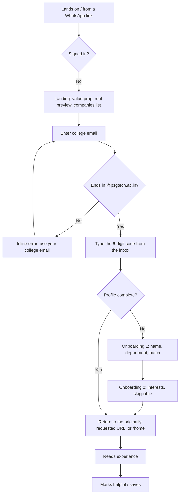
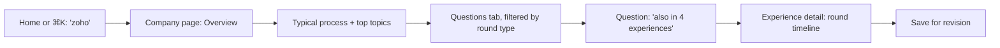
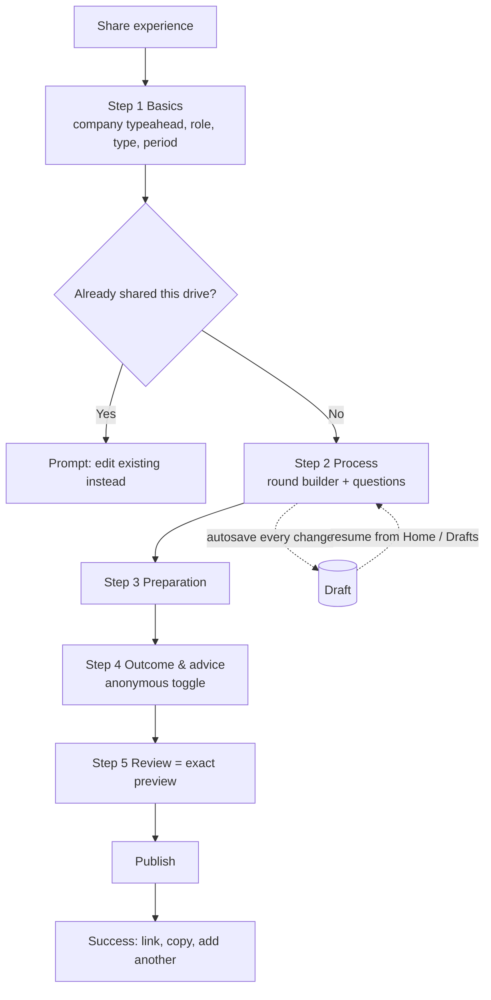
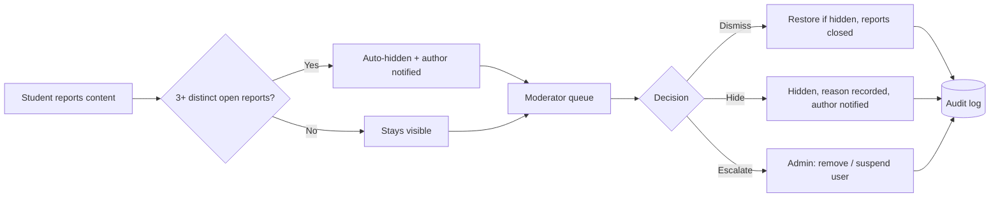

# Phase 1: UX Specification & Design System

> **Status:** DRAFT v0.1. Waiting for approval.
> **Date:** 2026-11-13 · **Depends on:** [01-product-discovery.md](01-product-discovery.md), [DECISIONS.md](DECISIONS.md)
> **Working name:** *Roundwise* (P16 / Q13). Every occurrence is a placeholder.

**Contents**
1. Design principles
2. Design tokens
3. Component library
4. System states (loading, empty, error, permission)
5. Accessibility standard
6. Voice & microcopy
7. Information architecture & navigation
8. User journeys
9. Page-by-page specifications (with wireframes and acceptance criteria)
10. Responsive strategy
11. Interaction & motion rules
12. Phase 1 exit checklist

---

## 1. Design principles

| # | Principle | In practice |
|---|---|---|
| 1 | **Content is the interface** | The detail page reads like a typeset article. Chrome recedes. Max reading width 68ch. |
| 2 | **Calm density** | Many facts per row, with a strict hierarchy: company → role → batch/outcome → signals. Never more than 1 accent-coloured element per card. |
| 3 | **Every number is real** | No decorative stats. Counts below thresholds are hidden, not faked. |
| 4 | **Colour means something** | Teal = action or link. Green / amber = status. Everything else is ink neutrals. |
| 5 | **Fast feels trustworthy** | Skeletons that match final layout, optimistic interactions, no full-page spinners after first paint. |
| 6 | **Respect the contributor** | Autosave everything. Never lose input. Explain why we ask for each field. |
| 7 | **Privacy by default** | Never show email. Anonymity actually anonymous. Private by default where in doubt. |

---

## 2. Design tokens

All tokens are CSS custom properties on `:root`, mapped into `tailwind.config.js`. Dark mode (v1.1) only redefines variables. Components never change.

### 2.1 Colour

**Ink: navy-tinted neutrals** (text, surfaces, borders)
| Token | Hex | Use | Contrast on white |
|---|---|---|---|
| `ink-25` | `#FCFCFD` | Raised hover on canvas | |
| `ink-50` | `#F7F8FA` | **Canvas** (app background) | |
| `ink-100` | `#F0F2F5` | Subtle fills, table header, skeleton base | |
| `ink-200` | `#E4E7EC` | **Line** (borders, dividers) | |
| `ink-300` | `#D0D5DD` | Input borders, strong dividers | |
| `ink-400` | `#98A2B3` | Placeholder, disabled text, decorative icons only | 2.6 ❌ text |
| `ink-500` | `#667085` | **Meta text** (timestamps, captions) | 5.0 ✅ (4.7 on canvas) |
| `ink-600` | `#475467` | Secondary body text | 7.7 ✅ |
| `ink-700` | `#344054` | Labels, strong secondary | 10.5 ✅ |
| `ink-800` | `#1D2939` | Body text | 14.7 ✅ |
| `ink-900` | `#0B1530` | **Headings**, primary text | 18.0 ✅ |

**Accent: deep teal** (D17)
| Token | Hex | Use |
|---|---|---|
| `teal-50` | `#EEF8F6` | Selected row, active chip background |
| `teal-100` | `#D3EFEA` | Hover on active chip, focus halo |
| `teal-200` | `#A7DED4` | Borders of active elements |
| `teal-500` | `#16907C` | Icons on dark teal-50 backgrounds |
| `teal-600` | `#0E7C6B` | **Primary buttons, links, focus ring** (5.1:1) |
| `teal-700` | `#0B6457` | Primary hover/pressed, link hover |
| `teal-800` | `#0A4F46` | Text on teal-50 |

**Semantic**
| Role | Foreground | Background | Border | Use |
|---|---|---|---|---|
| Success | `#15803D` | `#ECFDF3` | `#ABEFC6` | "Selected" outcome, success toasts |
| Warning | `#B45309` | `#FFFAEB` | `#FEDF89` | "Awaiting result", draft-unsaved |
| Danger | `#B42318` | `#FEF3F2` | `#FECDCA` | Destructive actions, validation errors only |
| Neutral | `ink-700` | `ink-100` | `ink-200` | "Not selected" (P12), "Withdrew", "Undisclosed" |

**Outcome pill mapping:** Selected → success · Awaiting → warning · Not selected / Withdrew / Undisclosed → neutral.

### 2.2 Typography

Family: **Geist Sans** (UI + reading), **Geist Mono** (code in questions, IDs in admin). Self-hosted via Fontsource, `font-display: swap`, subset to Latin. Numbers: `font-variant-numeric: tabular-nums` in stats and tables.

| Token | Size / line-height | Weight | Tracking | Use |
|---|---|---|---|---|
| `display` | 40 / 46 (mobile 32/38) | 600 | -0.025em | Landing hero only |
| `h1` | 30 / 38 (mobile 24/32) | 600 | -0.02em | Page titles |
| `h2` | 22 / 30 | 600 | -0.015em | Section titles |
| `h3` | 18 / 26 | 600 | -0.01em | Card titles, round titles |
| `body-lg` | 16 / 27 | 400 | 0 | **Reading** (experience body, questions) |
| `body` | 14 / 22 | 400 | 0 | Default UI text |
| `body-strong` | 14 / 22 | 500 | 0 | Labels, nav |
| `small` | 13 / 20 | 400 | 0 | Secondary meta, helper text |
| `caption` | 12 / 16 | 500 | 0.01em | Badges, table headers, overlines |
| `mono` | 13 / 20 | 400 | 0 | Code blocks, inline code |

### 2.3 Spacing, size, radius, elevation

- **Spacing scale (4px base):** 0, 2, 4, 6, 8, 12, 16, 20, 24, 32, 40, 48, 64, 80. Card padding 20 (mobile 16). Section gap 32 (mobile 24). Page top padding 32.
- **Control heights:** sm 32 · md 40 (default) · lg 48. Touch targets ≥ 44×44 on mobile. Icon buttons expand their hit area.
- **Radius:** `sm` 6 (chips, badges) · `md` 8 (buttons, inputs) · `lg` 12 (cards, panels) · `xl` 16 (modals, sheets) · `full` (avatars, pills).
- **Borders:** 1px `ink-200` by default. 1px `ink-300` for inputs. Focus: 2px `teal-600` ring + 2px offset `white`.
- **Elevation** (shadows only for things that float):

| Token | Value | Use |
|---|---|---|
| `shadow-xs` | `0 1px 2px rgba(16,24,40,.05)` | Cards at rest (with border) |
| `shadow-sm` | `0 1px 3px rgba(16,24,40,.08), 0 1px 2px rgba(16,24,40,.04)` | Card hover, sticky bars |
| `shadow-md` | `0 8px 24px -6px rgba(16,24,40,.12)` | Dropdowns, popovers, toasts |
| `shadow-lg` | `0 20px 48px -12px rgba(16,24,40,.18)` | Modals, bottom sheets, command palette |

- **Z-index:** base 0 · sticky 10 · header 20 · dropdown 30 · overlay 40 · modal 50 · toast 60.

### 2.4 Layout grid & breakpoints

| Breakpoint | Width | Layout |
|---|---|---|
| `base` | < 640 | Single column, 16px gutters, bottom nav, filters in bottom sheet |
| `sm` | ≥ 640 | Single column, 20px gutters |
| `md` | ≥ 768 | Top nav replaces bottom nav. 2-column dashboards. Filters still in a sheet. |
| `lg` | ≥ 1024 | Filter rail (264px) + content. Detail page gets a right aside. |
| `xl` | ≥ 1280 | Container max 1200px. Detail page: TOC (200) + article (680) + aside (280). |

Containers: `page` max 1200 · `reading` max 720 · `form` max 720 · `narrow` max 480 (auth).

### 2.5 Motion

| Token | Duration | Easing | Use |
|---|---|---|---|
| `fast` | 120ms | `cubic-bezier(.2,0,0,1)` | Hover, press, chip toggle |
| `base` | 180ms | `cubic-bezier(.2,0,0,1)` | Dropdown, popover, toast enter, accordion |
| `slow` | 260ms | `cubic-bezier(.2,0,0,1)` | Modal, bottom sheet, step transition |
| `exit` | 120ms | `cubic-bezier(.4,0,1,1)` | All exits (faster than enters) |

Allowed motions: opacity, translate ≤ 8px, scale 0.98→1. **Forbidden:** parallax, scroll-jacking, bouncing, animated gradients, looping decorative motion. `prefers-reduced-motion` disables translate and scale, keeping opacity only.

### 2.6 Iconography
Lucide only, at 16px (inline/meta), 18px (buttons) and 20px (nav), stroke 1.75. Icons never carry meaning alone: always a label or `aria-label`. No emoji in UI chrome.

**Round-type icon map:** Online assessment `MonitorCheck` · Aptitude `Calculator` · Coding `Code2` · Technical `Cpu` · System design `Network` · Group discussion `Users` · Managerial `Briefcase` · HR `HeartHandshake` · Other `CircleDot`.

---

## 3. Component library

Each component has: variants · sizes · states (default, hover, focus-visible, active, disabled, loading, error) · a11y notes. Built on Radix primitives where behaviour is non-trivial. Showcased on `/dev/ui` (dev builds only).

### 3.1 Primitives
| Component | Variants / notes |
|---|---|
| **Button** | `primary` (teal-600 bg, white) · `secondary` (white, ink-300 border, ink-800) · `ghost` (transparent, ink-700) · `danger` (danger fg on white, filled only in confirm dialogs) · `link`. Sizes sm/md/lg. Loading state keeps width and shows a spinner + "Saving…". Optional icon left/right. |
| **IconButton** | ghost / secondary. Requires `aria-label`. Tooltip on hover (desktop). |
| **Input** | Label above (always visible, never placeholder-as-label), helper text below, error text replaces helper (danger, with icon), optional prefix/suffix (e.g. suffix `@psgtech.ac.in`), character counter for limited fields. |
| **Textarea** | Auto-grows (min 4 rows, max 16 then scroll), counter at 80% of limit, optional Markdown hint ("**bold**, `code`, lists supported"). |
| **Select** (Radix) | For ≤ 12 options. Searchable variant for departments. |
| **Combobox** | Async typeahead: company picker with logos, "Add 'XYZ' as new company" row, keyboard navigable. |
| **TagPicker** | Multi-select chips with typeahead (topics). Max N enforced with message. |
| **Checkbox / Radio** | Standard plus **RadioCard** (large selectable cards for opportunity type and outcome). |
| **Switch** | For settings and the anonymous toggle. Always paired with a description. |
| **SegmentedControl** | 2–4 options (Online / Offline, sort order on mobile). |
| **DifficultyInput** | 5 segmented steps labelled Easy · Fair · Moderate · Hard · Very hard. Keyboard arrows. Ink-filled (not traffic-light). |
| **MonthYearPicker** | Month + year selects. No day precision (privacy, and people don't remember). |
| **Badge** | caption size, radius sm: `neutral`, `teal`, `success`, `warning`, `danger`. |
| **OutcomePill** | Badge + icon (Check / Clock / Minus). Mapping in §2.1. |
| **Chip** | Filter chip (toggle) and removable chip (active filters, with ×). |
| **Avatar** | Image or initials (deterministic ink tint from name hash). Sizes 24/32/40/64/96. Anonymous variant: `UserRound` icon on ink-100. |
| **CompanyLogo** | Logo image or monogram tile (radius md, ink-100 bg, ink-700 letters). Never coloured gradients. |
| **Tooltip** | Desktop hover/focus only. Never holds essential info. |
| **Kbd** | For ⌘K hints. |

### 3.2 Composite
| Component | Description |
|---|---|
| **ExperienceRow** | The core list item. See the anatomy below. |
| **ExperienceCard (compact)** | Dashboard and related lists. Logo, company, role, batch, outcome pill, helpful count. |
| **RoundPipeline** | Inline sequence of small labelled nodes, e.g. `OA → TECH → TECH → HR`, with a tooltip per node (type, mode, difficulty). Truncates to `+2` after 5. |
| **RoundTimeline** | Vertical stepper on the detail page. Node icon by type, header (Round N · Type · Mode · Duration · Difficulty), narrative (Markdown), questions list. |
| **QuestionItem** | Question body (Markdown, code-aware), kind badge (Coding / Technical / HR…), topic chips, "Also reported in N experiences" link (when N > 0), round reference on company pages. |
| **CompanyCard** | Logo, name, industry, experience count, last experience date, verified tick. |
| **InsightStat** | Label, value (tabular), sublabel ("from 14 experiences"), and the provenance tag "Student-reported". |
| **TopicBarList** | Horizontal bars (ink-300 track, teal-600 fill) with counts. For top topics. Accessible as a list. |
| **FilterRail / FilterSheet** | Same filter config rendered as a rail (≥ lg) or bottom sheet (< lg) with a sticky "Show N results" button. |
| **ActiveFilterBar** | Removable chips + "Clear all". |
| **Stepper** | Wizard progress: vertical list (desktop) / bar + "Step 2 of 5 · Process" (mobile). Completed steps are clickable. |
| **AutosaveIndicator** | `Saving…` → `Saved · just now` → `Offline, saved on this device`. |
| **MarkdownRenderer** | react-markdown with an allowlist: p, strong, em, code, pre, ul, ol, li, blockquote, a (https only, `rel="nofollow noopener noreferrer"`, `target="_blank"`), h3/h4 mapped down. No images, no HTML. |
| **CommandPalette** | ⌘K / Ctrl-K / search icon. Sections: Companies, Experiences, Pages. Recent searches stored locally. |
| **DataTable** (admin) | Sortable headers, row selection, sticky header, pagination, empty/loading rows. |
| **Drawer** | Right-side panel (admin/mod detail). Full-screen on mobile. |

### 3.3 Overlays & feedback
| Component | Rules |
|---|---|
| **Modal / Dialog** | Radix Dialog, focus trap, Esc closes (except unsaved forms, which ask first). Max width 480 (confirm) / 640 (forms). Bottom sheet on mobile. |
| **ConfirmDialog** | Title states the action ("Delete this comment?"), body states the consequence, buttons `Cancel` (secondary) + action (danger) labelled with the verb ("Delete"), never "OK". |
| **DropdownMenu** | Radix. Items with icons. Destructive items last, danger colour, separated. |
| **Toast** | Bottom-right (desktop) / bottom-center above bottom nav (mobile). Success 4s, info 5s, error persists until dismissed. Optional action ("Undo", "Retry"). Max 3 stacked. `aria-live="polite"` (errors: assertive). |
| **Banner** | Page-level, dismissible: announcement (admin-set), offline, suspended account. |
| **Skeleton** | Matches final layout. Shimmer at `ink-100 → ink-50`, 1.2s. Disabled under reduced motion. |

### 3.4 ExperienceRow anatomy (the most-seen component)

```
┌──────────────────────────────────────────────────────────────────────────────┐
│ [logo]  Amazon  ·  SDE Intern                                    [🔖 save]   │
│         Internship · On-campus · Aug 2025 · CSE '27        [✓ Selected]      │
│                                                                              │
│         OA → TECH → TECH                      Difficulty ▮▮▮▮▯  Hard         │
│                                                                              │
│         "Trace your approach out loud before coding; they cared more about   │
│          the brute-force → optimal journey than the final answer."           │
│                                                                              │
│         Arrays · DP · OS · +2           ▲ 24 helpful · 6 min read · 3d ago   │
└──────────────────────────────────────────────────────────────────────────────┘
```
- The whole row is a link (an `<a>` wrapping the title). Save is a separate button with `stopPropagation`, so there are no nested interactive traps.
- Advice quote is first 180 chars of `advice`, falling back to `preparation`, clamped to 2 lines.
- Topics: top 3 + overflow count.
- Hover: border `ink-300`, `shadow-sm`. Focus-visible: teal ring on the row.
- Anonymous: "Anonymous · CSE '27" (department hidden if the author chose P13).

---

## 4. System states

| State | Pattern | Example copy |
|---|---|---|
| **First load** | Layout skeleton (header, rail and 5 skeleton rows) | — |
| **Refetch** | Keep old data, 2px top progress bar | — |
| **Empty: no data yet** | Icon + title + one-line why + primary action | "No experiences for Zoho yet. Interviewed there? Your experience would be the first." `[Share experience]` |
| **Empty: no results** | Title + suggestions + clear filters | "No experiences match these filters. Try removing 'Very hard' or widening the batch range." `[Clear filters]` |
| **Inline validation error** | Field-level, on blur and on submit | "Add at least one round so readers know the process." |
| **Request error** | Inline card with retry, never a blank page | "Couldn't load experiences. Check your connection." `[Retry]` |
| **Offline** | Top banner, forms keep local autosave | "You're offline. Changes are saved on this device and will sync." |
| **Permission denied (403)** | Full page | "This area is for moderators." `[Go home]` |
| **Not found (404)** | Full page with search | "This experience was removed or never existed." |
| **Hidden content** | For author: banner on own post | "This post is hidden pending review after reports. You'll be notified of the outcome." |
| **Suspended** | Sign-in lands on a status page | "Your account is suspended until 20 Dec for: spam. Contact moderators." |
| **Crash** | Error boundary per route | "Something broke on this page." `[Reload]` · error ID for reporting |

---

## 5. Accessibility standard (WCAG 2.2 AA)

- Text contrast ≥ 4.5:1 (≥ 3:1 for ≥ 18px/600). Verified per token in §2.1.
- Full keyboard operation. Visible focus everywhere (teal ring, never removed). Skip-to-content link.
- Semantic landmarks (`header`, `nav`, `main`, `aside`), one `h1` per page, ordered headings.
- Form fields have programmatic labels and `aria-describedby` for helper and error text. Errors announced on submit with focus moved to the first error.
- Wizard: step change moves focus to the step heading and announces "Step 2 of 5, Process".
- Live regions for toasts, autosave status and result counts ("42 results").
- Touch targets ≥ 44px. No hover-only functionality.
- Respect `prefers-reduced-motion`. Don't depend on colour alone (outcome pills have icons, difficulty has a text label).
- Tooling: eslint-plugin-jsx-a11y, axe checks in Playwright, manual screen-reader pass (VoiceOver) in Phase 10.

---

## 6. Voice & microcopy

- **Tone:** a helpful senior. Direct, warm, never corporate, never hype.
- Sentence case everywhere. Buttons use verbs ("Share experience", "Save draft", "Publish"). No "Submit" and no "OK".
- Say *why* when asking ("Your batch helps juniors judge how recent this is.").
- No exclamation marks in UI chrome, and at most one in celebration moments.
- Glossary (consistent terms):

| Use | Not |
|---|---|
| experience | post, story, review |
| batch ('27) | year of passing, YOP |
| round | stage, level |
| helpful | like, upvote |
| save / saved | bookmark (in UI copy) |
| internship / full-time | FTE, intern (in UI) |
| on-campus / off-campus | — |

---

## 7. Information architecture & navigation

### 7.1 Navigation model
- **Top nav (≥ md):** Logo · Home · Explore · Companies · *(Questions, v1.1)* — Search (⌘K) — `Share experience` (primary button) — Avatar menu.
- **Bottom nav (< md):** Home · Explore · **Share** (centered, accent) · Saved · Me.
- **Avatar menu:** My profile · Saved · Drafts · Settings · *(Moderation)* · *(Admin)* · Sign out. Role items are rendered only when the role exists, and the route is still guarded on the server.
- **Breadcrumbs** on detail and company pages: `Companies / Amazon / SDE Intern (Aug 2025)`.

### 7.2 Content model (what links to what)
```
Company ─┬─ Experiences ─┬─ Rounds ── Questions ── Topics
         │               ├─ Topics
         │               └─ Resources
         ├─ Insights (derived from its experiences)
         └─ Questions (all questions from its experiences)

Topic ── Questions (across companies)  → question bank (v1.1)
Student ── Experiences (non-anonymous only on public profile)
```
Every entity page links to its neighbours. A reader can go *question → other experiences with the same question → that company → its typical process* without searching.

### 7.3 URL conventions
- Experiences: `/experiences/:id` (uuid). Company slugs are human-readable: `/companies/amazon`.
- All list state lives in the query string (`?company=amazon&type=internship&outcome=selected&sort=helpful`), so links are shareable and the back button restores state.
- Wizard drafts: `/share/:draftId?step=2`.

---

## 8. User journeys

### J1: First-time student, from visit to first read

Deep links survive sign-in: the requested path is stored before auth and restored after onboarding.

### J2: Candidate preparing for a company visiting this week


### J3: Contributor after an interview


### J4: Moderation


---

## 9. Page-by-page specifications

Template for each page: **Purpose · Users · Workflow · Layout & wireframe · Components · Data · Backend · Security · States · Acceptance criteria.**

---

### 9.1 Landing `/`

- **Purpose:** explain the value in 5 seconds and convert PSG students to sign in. Signed-in users are redirected to `/home`.
- **Users:** visitors (mostly PSG students arriving from links).
- **Layout (desktop):**
```
┌ Header: Logo ··················· About · Guidelines ········ [Sign in] ┐
│                                                                        │
│  Real interview experiences from PSG students.        ┌──────────────┐ │
│  Company by company, round by round.                   │ (product     │ │
│                                                        │  preview:    │ │
│  Read how seniors cracked (or didn't) their            │  real Exp.   │ │
│  interviews: every round, every question.              │  row + round │ │
│                                                        │  timeline)   │ │
│  [G  Continue with your PSG account]                   └──────────────┘ │
│  Only @psgtech.ac.in accounts · anonymous sharing available            │
│                                                                        │
│  ── 128 experiences · 46 companies · 9 departments ── (only if ≥ 25)   │
│                                                                        │
│  Companies covered:  [logo][logo][logo][logo][logo][logo]  View all →  │
│                                                                        │
│  How it works:  1 Read the rounds  2 Prepare by topic  3 Give back     │
│                                                                        │
│  What you'll find (3 panels with real UI crops):                       │
│   Round-by-round timelines │ Questions by topic │ Company insights     │
│                                                                        │
│  Trust: Verified PSG only · Anonymous option · Moderated by students   │
│                                                                        │
│  FAQ (accordion, 5 questions)                                          │
│  Footer: About · Guidelines · Privacy · Terms · Contact               │
└────────────────────────────────────────────────────────────────────────┘
```
- **Mobile:** headline → CTA → preview below → rest stacked. Sticky bottom CTA appears after scrolling past the hero.
- **Components:** Button, CompanyLogo, static ExperienceRow (sample from real data when available, otherwise a clearly labelled example), Accordion.
- **Data:** `get_public_stats()` RPC (counts, top 12 companies by experience count). No experience content is exposed (D11).
- **Backend:** one RPC callable by `anon`, returning aggregates only. Cached (ISR-like via `Cache-Control` on an Edge Function, or a 5-minute client cache).
- **Security:** RPC returns no PII and no text content.
- **States:** stats hidden under threshold. Companies strip hidden when empty (no "No companies yet" on the landing page).
- **Acceptance:**
  - [ ] Signed-in user visiting `/` is redirected to `/home` without a flash of the landing page.
  - [ ] Stats never render when below the threshold, and never show placeholder numbers.
  - [ ] Lighthouse (mobile): Performance ≥ 90, Accessibility ≥ 95.
  - [ ] Anon network calls return no experience text.

---

### 9.2 Sign in `/login`

> Revised 2026-11-14 for D19: **college email + 6-digit code is the only sign-in method.**

- **Purpose:** prove the student owns an official @psgtech.ac.in mailbox, with as little friction as possible.
- **Layout:**
```
┌───────────────────────────── narrow (440) ──────────────────────────────┐
│  [Logo]                                                                 │
│  Sign in with your college email                                        │
│  We’ll send a 6-digit code to your @psgtech.ac.in inbox.                │
│                                                                         │
│  College email                                                          │
│  [ 22z201            ][@psgtech.ac.in]   ← suffix fixed; pasting the    │
│                                            full address also works      │
│  [ ✉ Send code ]                                                        │
│  By continuing you agree to the Guidelines and Privacy policy.          │
└─────────────────────────────────────────────────────────────────────────┘

  Code step:
  Enter the 6-digit code sent to 22z201@psgtech.ac.in   [Change email]
  [ _ ][ _ ][ _ ][ _ ][ _ ][ _ ]   (paste fills all; auto-submit on 6th)
  Resend code in 0:28
```
- **Workflow:** `signInWithOtp({ email, options: { shouldCreateUser: true } })` → email template sends `{{ .Token }}` (a code, not a link) → `verifyOtp({ email, token, type: 'email' })` → route guard decides `/onboarding` or the stored return path.
- **Error states (copy):**
  | Case | Message |
  |---|---|
  | Non-college address typed or pasted | "Use your college email ending in @psgtech.ac.in. Personal email addresses can’t be used." (inline, before any request) |
  | Non-college address sent to the API directly | Server rejects with 403 "Only @psgtech.ac.in accounts can join." (auth hook) |
  | Wrong code | "That code doesn’t match. Check the latest email." |
  | Expired code | "This code expired. We’ve sent a new one." |
  | Rate limited | "Too many attempts. Try again in 10 minutes." |
  | Email not received | Help text after 60s: "Check Spam/Promotions. Codes come from no-reply@<domain>." |
- **Security:** the domain is enforced by the auth hook and the `auth.users` trigger (server), and re-checked by every RLS policy. Rate limits apply to code sending and verifying. Messages never reveal whether an account exists.
- **Acceptance:**
  - [x] A non-PSG address cannot create a user: verified against the local Auth server (403) and by pgTAP.
  - [ ] Deep link `/experiences/abc` → sign in → onboarding → lands on `/experiences/abc`.
  - [ ] Code input supports paste, backspace across boxes, and screen readers (single input with `autocomplete="one-time-code"` visually split).
  - [ ] Codes reach real @psgtech.ac.in inboxes (not Spam) from the production sender (A3).

### 9.3 Onboarding `/onboarding`

- **Purpose:** collect the minimum profile (D8) in under 30 seconds.
- **Layout:** centered card (form container 560), a 2-step mini progress bar.
  - **Step 1, About you (required):** Full name · Department/programme (searchable select, grouped by degree) · Batch / graduation year (select, current−4 … current+5) · Photo (optional, `[Upload]` `[Remove]`). Helper text: "Department and batch are shown on your experiences so juniors can judge relevance."
  - **Step 2, Interests (optional):** target roles (chips: SDE, Data/ML, Core engineering, Product, Consulting, Finance/Quant, Design, Other) · topics you're preparing (TagPicker). `[Skip]` `[Finish]`.
- **Backend:** `profiles` upsert of own row only. `onboarded_at` set by `complete_onboarding()` RPC that validates required fields.
- **Security:** RLS `id = auth.uid()`. Column grants exclude `status` and role.
- **Acceptance:**
  - [ ] Until `onboarded_at` is set, every gated route redirects to `/onboarding`.
  - [ ] Name 2–80 chars, department required, year in range: same rules on client (zod) and DB (CHECK).
  - [ ] Avatar upload: ≤ 2 MB, png/jpeg/webp, resized to 256px client-side, stored at `avatars/{uid}/…`.

---

### 9.4 Dashboard `/home`

- **Purpose:** a starting point that adapts to where the student is in their placement journey.
- **Layout (desktop, 2/3 + 1/3):**
```
┌ Good evening, Ashok                                   [+ Share experience] ┐
│ ┌ Continue your draft: Zoho · Member Technical Staff · step 3 of 5  [Resume]┐│
├────────────────────────────────────────────────┬───────────────────────────┤
│ New this week                       See all →  │ Recently viewed           │
│  ExperienceRow ×4                              │  compact ×4               │
│                                                │                           │
│ Trending companies (last 30 days)              │ Saved             See all │
│  [CompanyCard][CompanyCard][CompanyCard] →     │  compact ×3               │
│                                                │                           │
│ From your department (CSE)                     │ Your impact               │
│  ExperienceRow ×3                              │  2 experiences · 41 helpful│
│                                                │  · read 380 times         │
│                                                │  (or: "Interviewed       │
│                                                │  recently? Help juniors" │
│                                                │  [Share])                 │
└────────────────────────────────────────────────┴───────────────────────────┘
```
- **Mobile:** greeting → draft card → New this week → Trending (horizontal scroll) → From your department → Recently viewed. The aside collapses into the flow.
- **Data:** `experience_feed` (latest, by department), `trending_companies(30d)` RPC, `experience_views` (own), `bookmarks` (own), `my_stats()` RPC, own drafts.
- **Personalization rule (MVP, transparent):** "From your department" uses `profile.department_id`. Final-year and recent-graduate batches see the "Help juniors" prompt more prominently.
- **Acceptance:**
  - [ ] Each section loads independently with its own skeleton. One failing section doesn't blank the page.
  - [ ] Draft card shows only if a draft exists. Resume opens the exact step.
  - [ ] "Your impact" numbers equal DB counts (tested).

---

### 9.5 Experience explorer `/experiences`

- **Purpose:** find relevant experiences fast.
- **Layout (≥ lg):**
```
┌ Explore experiences                                                        ┐
│ [🔍 Search company, role, topic or question…              ] [Sort: Latest ▾]│
├──────────────── Filter rail (264) ─────┬───────────────────────────────────┤
│ Company      [ type to search… ]       │ 42 experiences   [Amazon ×][Intern×]│
│ Type         ☐ Internship  ☐ Full-time │                       Clear all    │
│              ☐ Intern + PPO ☐ Intern+FT│ ExperienceRow                      │
│ Hiring       ☐ On-campus ☐ Off-campus  │ ExperienceRow                      │
│              ☐ Referral                │ ExperienceRow                      │
│ Outcome      ☐ Selected ☐ Not selected │ …                                  │
│              ☐ Awaiting                │                                    │
│ Difficulty   [1][2][3][4][5]           │        [ Load 20 more ]            │
│ Department   [ multi-select ▾ ]        │   Showing 20 of 42                 │
│ Batch        [ '24 ][ '25 ][ '26 ][ '27 ]                                  │
│ Has round    ☐ System design ☐ GD      │                                    │
└────────────────────────────────────────┴───────────────────────────────────┘
```
- **Mobile:** sticky search + `[Filters · 3]` + sort segmented control. Filters open as a bottom sheet with live count `[Show 42 results]`. Active chips scroll horizontally under the search.
- **Search:** Postgres full-text across company name/aliases, role, topics, questions and body (weighted: company/role A, topics/questions B, body C), plus trigram for company typos. Debounced 300ms. Minimum 2 chars.
- **Sort:** Latest (`published_at`) · Most helpful (`helpful_count`, ties by recency) · Most read (`view_count`).
- **Pagination:** keyset cursor `(sort_value, id)`, 20 per page, "Load more" (D10). Page state in URL (`&limit=60` restores depth on back).
- **Backend:** `search_experiences(params)` RPC (`SECURITY INVOKER`, uses the masked feed view), returning rows + total count (count capped/estimated beyond 1,000).
- **Acceptance:**
  - [ ] Every filter combination is reflected in the URL. Reload or share reproduces the identical result set.
  - [ ] Back from a detail page restores scroll position and loaded depth.
  - [ ] p95 query < 300 ms with 5,000 seeded experiences.
  - [ ] Anonymous experiences return no author fields in the network payload.
  - [ ] Zero-result state suggests which filter to remove.

---

### 9.6 Experience detail `/experiences/:id`

- **Purpose:** the complete interview journey, readable and actionable.
- **Layout (xl):**
```
Companies / Amazon / SDE Intern (Aug 2025)
┌ TOC (200) ──┬──────────── Article (680) ─────────────────┬─ Aside (280) ───┐
│ Overview    │ [logo] SDE Intern at Amazon                 │ Amazon          │
│ Eligibility │ Internship · On-campus · Aug 2025           │ 14 experiences  │
│ Process     │ [avatar] Priya R · CSE '27   or  Anonymous  │ Usual process:  │
│ Round 1 OA  │ [✓ Selected]                                │ OA→TECH→TECH    │
│ Round 2 Tech│ [▲ Helpful 24] [Save] [Share] [⋯]           │ Top topics:     │
│ Round 3 Tech│                                             │ Arrays, DP, OS  │
│ Preparation │ ┌ At a glance ─────────────────────────────┐│ [View company →]│
│ Advice      │ │ 3 rounds · Hard (4/5) · 9 questions · 6m ││                 │
│ Comments    │ └──────────────────────────────────────────┘│ Related         │
│             │ Eligibility  (CGPA ≥ 7, CSE/IT/ECE, no …)   │  compact ×4     │
│             │ Application process  (prose)                │                 │
│             │ Interview rounds                            │                 │
│             │  ● Round 1 · Online assessment · 90 min · ▮▮▮▯▯              │
│             │    narrative…                               │                 │
│             │    Questions                                │                 │
│             │    1. Longest substring without repeating…  │                 │
│             │       Coding · Strings · Sliding window     │                 │
│             │       Also in 3 experiences →               │                 │
│             │  ● Round 2 · Technical · Online · 60 min …  │                 │
│             │ Preparation  topics chips · strategy · resources              │
│             │ ┌ Advice for juniors (teal-50 callout) ────┐│                 │
│             │ Was this helpful?  [▲ Helpful]  [Save]      │                 │
│             │ Comments (6)  …                             │                 │
└─────────────┴─────────────────────────────────────────────┴─────────────────┘
```
- **Mobile:** single column. The TOC becomes a "Jump to" select. A sticky bottom action bar (Helpful · Save · Share) replaces header actions after scrolling. The aside moves below the comments.
- **Owner view:** `[Edit]` in the header. If hidden: a banner (see §4). Edits show "Edited 12 Nov".
- **Overflow menu (⋯):** Copy link · Report · (owner) Edit / Delete · (moderator) Hide.
- **Comments:** newest-first toggle, 1-level replies, 2,000 char limit, Markdown subset, edit within 15 min, own delete, report. Collapsed after 5 with "Show all".
- **Related experiences:** same company first, then same role family + type, excluding the current one.
- **Backend:** `get_experience(id)` RPC returns experience + rounds + questions + topics + resources in one call (masked author). `record_view(id)` upsert (deduped per user per 24h, increments `view_count` via trigger). `toggle_helpful(id)` / `toggle_bookmark(id)` return new state + count.
- **Security:** published or own or moderator only. Can't vote on own post. Report is unique per user per target.
- **Acceptance:**
  - [ ] Helpful toggle is optimistic, reconciles with the server count, and can't go negative under rapid clicks (tested).
  - [ ] An anonymous post shows no author in UI *or* payload. The author still sees "Edit".
  - [ ] Markdown with `<script>`, `javascript:` links or images renders inert (unit tests with an XSS payload list).
  - [ ] TOC highlights the current section. Deep link `#round-2` scrolls correctly.

---

### 9.7 Companies directory `/companies`

- **Layout:** title + search + industry filter (chips) + sort (Most experiences · A–Z · Recently active) → responsive grid of CompanyCards (1 / 2 / 3 / 4 columns). Unverified companies show no tick and are listed normally.
- **Data:** `companies_with_stats` view (experience count, last experience date) excluding merged companies.
- **Acceptance:**
  - [ ] Searching "tcs" finds "Tata Consultancy Services" (aliases).
  - [ ] Companies with 0 published experiences are hidden from the directory (still visible in admin).

---

### 9.8 Company page `/companies/:slug`

- **Layout:**
```
┌ [LOGO]  Zoho Corporation  ✓                      [+ Share a Zoho experience]┐
│ Software · zoho.com ↗                                                        │
│ About (Source: company website)  — 2 lines, expand                           │
│ [ Overview ] [ Experiences 14 ] [ Questions 63 ]                             │
├──────────────────────────────────────────────────────────────────────────────┤
│ Overview: STUDENT-REPORTED · from 14 experiences (2024–2026)                 │
│ ┌ Experiences 14 ┐┌ Avg difficulty 3.6 ┐┌ Reported selected 6 of 11 ┐┌ Latest Oct 2025┐│
│ Typical process (most common sequence, 9 of 14):                             │
│   APT → CODE → TECH → TECH → HR                                              │
│ Other sequences seen: CODE → TECH → HR (3) …                                 │
│ Most reported topics            Rounds by type                               │
│   Arrays        ▮▮▮▮▮▮▮ 18        Technical  ▮▮▮▮▮ 22                         │
│   DBMS          ▮▮▮▮▮ 12          Coding     ▮▮▮ 13                          │
│   OOP           ▮▮▮▮ 10           HR         ▮▮ 11                           │
│ Experiences by batch:  '24 ▮▮  '25 ▮▮▮▮▮  '26 ▮▮▮▮▮▮▮                        │
│ Latest experiences: ExperienceRow ×3        [See all 14 →]                   │
└──────────────────────────────────────────────────────────────────────────────┘
```
- **Experiences tab:** the explorer pre-filtered by company (same component, company filter locked).
- **Questions tab:** all questions grouped by topic (default) or by round type. Filter by kind (Coding / Technical / HR…) and batch. Each QuestionItem links to its experience.
- **Provenance (requirement):** every derived block carries a "Student-reported · from N experiences" label. Official description shows its source. "Selected 6 of 11" counts only experiences that disclosed an outcome, and says so in a tooltip.
- **Threshold (P14):** insights render only when N ≥ 3. Otherwise: "Not enough experiences for insights yet: 2 so far." The Experiences and Questions tabs still work.
- **Backend:** `get_company_insights(slug)` RPC (aggregations in SQL). Materialized-view refresh is unnecessary at MVP scale. Reconsider at > 10k experiences.
- **Acceptance:**
  - [ ] Every insight number matches a hand-computed fixture (SQL test).
  - [ ] Anonymous experiences count in aggregates, but no author data leaks.
  - [ ] Merged companies 301-redirect to the target slug.

---

### 9.9 Share experience wizard `/share`, `/share/:draftId`

- **Purpose:** make a high-quality contribution easy in about 10–15 minutes, without losing work.
- **Shell layout (≥ lg):**
```
┌ Share your experience                       Saved · just now   [Save & exit]┐
├ Steps (220) ──────┬──────── Form (720) ──────────────────────────────────────┤
│ ✓ 1 Basics        │  Step 2 of 5 · Process                                    │
│ ● 2 Process       │  Tell juniors how the process worked, round by round.    │
│ ○ 3 Preparation   │  …fields…                                                 │
│ ○ 4 Outcome       │                                                           │
│ ○ 5 Review        │                                                           │
│                   ├───────────────────────────────────────────────────────────┤
│ Tips for a great  │  [← Back]                                [Continue →]     │
│ experience  (box) │                                                           │
└───────────────────┴───────────────────────────────────────────────────────────┘
```
- **Mobile:** progress bar + "Step 2 of 5 · Process" at top, sticky footer `[Back] [Continue]`, autosave status in header.

**Step 1: Basics** (required unless marked)
| Field | Control | Rules |
|---|---|---|
| Company | Combobox with logos + "Add new company" | Required. A new company is created as unverified on publish (not on draft). |
| Role title | Input with suggestions (popular roles for that company) | 2–100 chars |
| Opportunity type | RadioCards: Internship · Full-time · Internship + PPO · Internship + Full-time | Required |
| Hiring mode | Segmented: On-campus · Off-campus · Referral · Other | Required |
| When did you interview? | MonthYearPicker | Not in the future, not before 2015 |
| Department · Batch | Prefilled from profile, editable ("Shown with the experience") | Required |

After Step 1: **duplicate check.** If the author already has a non-removed experience with the same company + role + type + batch, show a dialog: "You already shared an experience for Amazon SDE Intern ('27). Edit that one instead?" `[Edit existing]` `[This is a different interview]`. The second option requires a one-line reason and is logged.

**Step 2: Process**
| Field | Control | Rules |
|---|---|---|
| Eligibility *(optional)* | Small structured group: CGPA cutoff (number), eligible branches (multi), backlogs allowed (Y/N/unknown), other (text) | |
| How did you apply? *(optional)* | Textarea | ≤ 2,000 |
| **Rounds** | Round builder: `[+ Add round]` and templates (`OA + 2 Technical + HR`, `Aptitude + GD + Technical + HR`). Each round is a collapsible card: type (select with icons) · mode (online/offline) · duration (min, optional) · difficulty · "What happened" (textarea, Markdown) · **Questions** list (add, reorder by drag *and* keyboard up/down buttons, each with kind + topic tags) | ≥ 1 round. Each round needs a type + (description ≥ 30 chars **or** ≥ 1 question). ≤ 12 rounds, ≤ 25 questions per round. |

**Step 3: Preparation**
| Field | Control | Rules |
|---|---|---|
| Topics covered | TagPicker (curated taxonomy). Pre-suggested from question tags. | ≤ 15 |
| Preparation strategy | Textarea + prompt chips ("How long did you prepare?", "What did you focus on?") | Recommended, ≤ 5,000 |
| Resources | Repeater: title + https URL + kind (Course / Book / Practice site / Video / Other) | ≤ 15, URL https only |

**Step 4: Outcome & advice**
| Field | Control | Rules |
|---|---|---|
| Overall difficulty | DifficultyInput | Required |
| Result | RadioCards: Selected · Not selected · Awaiting result · Withdrew · Prefer not to say | Required |
| Advice for juniors | Textarea with a placeholder example | Recommended, ≤ 3,000 |
| Post anonymously | Switch + explanation: "Readers won't see your name or profile. Admins can see it only to handle abuse." Sub-option (P13): ☐ Also hide my department | Default off (configurable in settings) |
| Confirmation | Checkbox: "This is my own experience and doesn't include confidential test content I agreed not to share." | Required to publish |

**Step 5: Review**
- Renders the **exact detail-page component** in preview mode.
- Completeness checklist (non-blocking): "Add questions to Round 2", "Advice is empty: juniors value this most."
- `[Edit]` links jump to the step + field. `[Publish]` (primary).
- **Success screen:** "Published. Thank you, this will help a lot of juniors." · `[View experience]` `[Copy link]` · "Interviewed for an internship and a PPO? `[Share another]`".

**Autosave & drafts**
- Draft row created on first meaningful change in Step 1 (company or role). Debounced save 1.5s after the last change, plus on step change and `visibilitychange`.
- Local fallback (IndexedDB/localStorage keyed by draft) when offline. Synced on reconnect. Conflict rule: the server copy wins only if newer than the local copy, otherwise "Keep this device's version / Use saved version".
- Leaving with unsynced changes triggers `beforeunload` plus an in-app confirm.
- Drafts listed in Home (latest) and `/me` → Drafts. Drafts are deleted after 90 days idle (with notice).
- Editing a published experience uses the same wizard. "Update" re-runs validation. Edits are versioned (`version` + `updated_at`). "Edited" label is shown.

- **Backend:** drafts stored as `experiences(status='draft')` + child rows, written via `save_draft(payload)` RPC (one transaction, replaces children). `publish_experience(id)` validates server-side (the same rules as zod), applies rate limit (5/day), creates the unverified company if needed, sets `published_at`, writes audit.
- **Security:** drafts visible only to the owner. All limits enforced in DB. HTML is never stored as such: Markdown text only, sanitized at render.
- **Acceptance:**
  - [ ] Kill the tab mid-Step 2 → reopen `/share/:id` → all input is present.
  - [ ] Offline edits sync on reconnect without duplicate rounds or questions.
  - [ ] Publishing an invalid payload crafted via the API is rejected with field-specific errors.
  - [ ] Keyboard-only users can add, reorder and remove rounds and questions.
  - [ ] Duplicate prompt appears for same company + role + type + batch.

---

### 9.10 Saved `/saved`
- List of saved experiences (ExperienceRow) with search within saved, sort by saved date or company, and unsave with an Undo toast. Private (RLS owner-only).
- **Acceptance:** [ ] An experience hidden or removed after saving shows as "No longer available" with a remove action, not a broken row.

---

### 9.11 My profile `/me` and public profile `/u/:handle`
- **/me layout:** header (avatar 96, name, department · batch, bio, `[Edit profile]`), stats row (Experiences · Helpful received · Times read), tabs: **Published** (incl. anonymous ones, marked "Anonymous") · **Drafts** · **Saved**.
- **/u/:handle:** avatar, name, department · batch, bio, **non-anonymous** published experiences only, and helpful-received count. If visibility is "Only me", show a minimal card ("This profile is private") with no experience list.
- **Security:** anonymous experiences never appear on, or are counted in, public profile output (tested). Handles are generated (`ashok-k`) and editable once per 30 days.
- **Acceptance:** [ ] No network response for `/u/:handle` contains the author's anonymous experiences, email or roll number.

---

### 9.12 Settings `/settings`
| Section | Contents |
|---|---|
| Profile | Name, photo, department, batch, bio (≤ 280), interests, handle |
| Privacy | Profile visibility (PSG students / Only me) · Default to anonymous for new experiences · Hide department on anonymous posts by default |
| Notifications *(v1.1)* | Comments on my experiences, replies, moderation outcomes |
| Account | Signed in as `22e646@psgtech.ac.in` (visible only to the user) · Sign-in method (6-digit code to the college email; *(v1.1)* linked personal email for alumni) · Sign out of all devices · Export my data (JSON) · Delete account (D14 choice + typed confirmation) |

**Acceptance:** [ ] Account deletion with "keep anonymised" leaves experiences readable with author "Former PSG student" and deletes the profile, votes, saves and views (tested).

---

### 9.13 Moderation `/mod`
- **Layout:** tabs **Open reports** · **Hidden content** · **Resolved**. DataTable columns: Content (type icon + title/excerpt) · Top reason · Reports (#) · First reported · Status. Row opens a Drawer: full content preview, all reports (reason + note, reporter identity hidden from moderators and visible to admins), author history (prior actions count), actions: `Dismiss` · `Hide` (reason required, message to author) · `Escalate to admin`.
- **Rules:** a moderator can't act on their own content or reports about themselves. Every action writes `moderation_actions` + `audit_logs`.
- **Acceptance:** [ ] A student calling moderation RPCs directly receives a permission error (SQL test). [ ] Hide/restore round trip updates visibility everywhere immediately.

---

### 9.14 Admin `/admin/*`
| Page | Contents |
|---|---|
| **Overview** | KPI cards: Verified students · New (7d) · Published experiences · New (7d) · Open reports · Median resolution time. Simple weekly bar charts (CSS bars, no chart lib in MVP): sign-ups, publishes. Top companies (30d). |
| **Users** | Search (name, handle, email; admin-only field), filters (role, status, department, batch). Row drawer: profile, contributions, reports against, actions: Suspend (duration + reason) / Unsuspend / Set role (moderator/admin, confirm dialog, cannot demote the last admin). |
| **Companies** | Table with verified/unverified filter. Create/edit (name, aliases, industry, website, logo upload, description + source). **Merge tool:** pick duplicate → target, preview affected experiences, confirm. Old slug redirects. |
| **Reports** | All reports incl. escalated, with full reporter identity, plus remove/suspend actions. |
| **Audit log** | Filter by actor, action, entity, date. Immutable. Export CSV. |
| **Settings** | Announcement banner (text, type, expiry) · Feature flags (comments, anonymous posting, new-company creation) · Rate limits (publish/day, comments/hour) · Landing stats threshold |

**Acceptance:** [ ] Every admin mutation appears in the audit log with actor, before/after (tested). [ ] Unmasking an anonymous author requires a reason and is audited.

---

### 9.15 Static & system pages
- **About:** honest story, who runs it, how moderation works, how to contact. No fake claims.
- **Guidelines:** what to share or not share (no confidential test content you agreed not to share, no personal attacks on interviewers, no misleading info), consequences.
- **Privacy:** what's collected (§7 of doc 01), who sees what, anonymity guarantees and limits, deletion.
- **404 / 403 / suspended / error boundary:** see §4.

---

## 10. Responsive strategy

| Concern | < 768 (mobile) | 768–1023 (tablet) | ≥ 1024 (desktop) |
|---|---|---|---|
| Navigation | Bottom nav (5) + top bar (logo, search, avatar) | Top nav | Top nav + ⌘K |
| Explorer filters | Bottom sheet | Bottom sheet | Left rail |
| Experience list | Full-width rows, advice clamped to 2 lines | Same | Same + filter rail |
| Detail page | Single column, "Jump to" select, sticky bottom actions | Single column, aside below | TOC + article + aside (xl), article + aside (lg) |
| Wizard | Progress bar, sticky footer, full-screen round editor sheets | Same with wider form | Step rail + form |
| Company insights | Stacked cards, horizontal-scroll stat row | 2-column | 2-column + stat row |
| Admin tables | Card list per row (no horizontal scroll) | Table with priority columns | Full table |
| Modals | Bottom sheets | Centered | Centered |

- Mobile-first CSS. Test widths: 360, 390, 768, 1024, 1280, 1440.
- Performance budget: initial JS ≤ 180 KB gzip (route-level code splitting: admin, mod and wizard are lazy). LCP < 2.5s on 4G mid-range Android. CLS < 0.05 (skeletons sized to content).
- Images: logos as small webp/svg (admin-uploaded SVGs are sanitized or rasterized), avatars 256px webp, `loading="lazy"`.

---

## 11. Interaction & motion rules

| Interaction | Behaviour |
|---|---|
| Helpful / Save | Optimistic toggle, 120ms scale 0.96→1 on the icon, count ticks. Rolls back with an error toast on failure. |
| Filter change | URL updates immediately. List shows a top progress bar and keeps old results (dimmed 0.6) until new ones arrive. Never clears to a skeleton. |
| Load more | Button shows a spinner, new rows fade in (180ms), focus moves to the first new row for keyboard users. |
| Wizard step | Content cross-fades with 8px slide (260ms). Focus moves to the step heading. Validation errors scroll to the first error. |
| Round card | Expand/collapse with height animation (180ms). New round auto-expands and focuses its type field. |
| Toasts | Slide up 8px + fade (180ms). Exit 120ms. |
| Sheets/Modals | Overlay fade 180ms. Sheet translateY 100%→0 (260ms). Swipe-down to close on mobile sheets. |
| Copy link | Button label changes to "Copied" for 2s (no toast spam). |
| Destructive | Always confirm, *except* reversible ones (unsave, delete own comment), which use an Undo toast instead. |

---

## 12. Phase 1 exit checklist

- [ ] You approve: tokens (colour, type, spacing), the component inventory and the page specs above.
- [ ] You decide the final name (Q13), or approve continuing with the placeholder.
- [ ] Proposals P11–P16 approved or changed.
- [ ] Next: **Phase 2** turns this spec into an interactive, clickable React prototype (mock data, every page and state above, mobile and desktop) before any Supabase work. That's where you review real interactions rather than descriptions.
